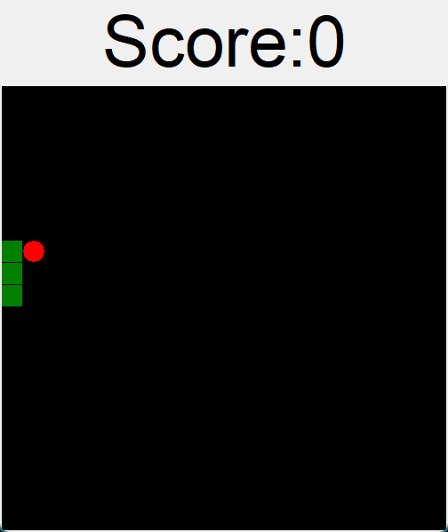

# Python Snake Game

A classic Snake game in Python with a Tkinter window. Eat the red food to grow and score points. The game ends if you hit a wall or your own body.



## The story

I built this from scratch at the **Python Snake Game Workshop** run by the UBT Game Development Club (7 November 2024). The instructor walked us through it step by step, and we wrote the code ourselves.

The comments in `snake.py` mark mistakes from an earlier version of the code and how they were fixed:

- `coordinate` was misspelled (should be `coordinates`)
- `change_direction()` and `check_collisions()` were missing their parameters
- The direction check compared `new_direction` instead of the current `direction`, so the snake could turn back into itself

**Updated November 2026:** newer Python versions (3.12+) crashed when placing the food, because `random.randint()` only accepts whole numbers and `/` gives a decimal. Changing `/` to `//` (whole-number division) fixed it.

## How to play

| Key | Move |
| --- | --- |
| ← → ↑ ↓ | Change direction |

## How to run

1. Install [Python](https://www.python.org/downloads/) (Tkinter comes with it).
2. Download this repo.
3. Run:

```
python snake.py
```

## Built with

- Python
- Tkinter (window, canvas, keyboard input)
- `random` (food position)

## What I learned

- Using classes for game objects (`Snake`, `Food`)
- A game loop with `window.after()`
- Handling keyboard input and collisions
- Reading error messages and fixing bugs
